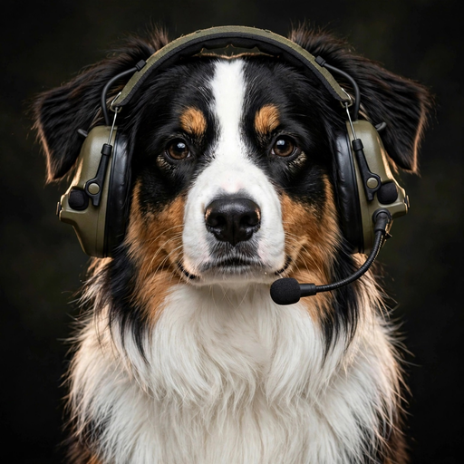
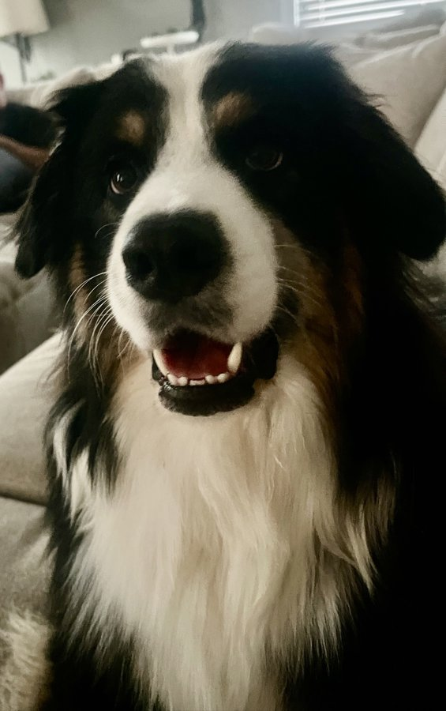

# Pack Out

**By Shepherd** — by MSgt Jeremy Davis and Cooper

A self-contained equipment checkout station that runs entirely on **one Android tablet**. No server, no member phones, no network needed to run it. Gear checks out and back in with a few taps, and everything — registry, roster, log, photos — lives on the tablet.

Built for a Samsung Galaxy Tab S6 Lite on a stand by the door, but any reasonably modern Android tablet works.

## ▶ Try the web sim

**[Launch the live sim →](https://ShepherdSense.github.io/Pack-Out/sim/)**

<a href="https://ShepherdSense.github.io/Pack-Out/sim/"></a>

This is the **real app**, compiled for the web and locked to a demo mode — the same screens, the same flows, the same voice. The gear room is in-memory sample data (radios, lasers, optics, tools… and Cooper, filed under **Dog → Aussie**, serial `GOOD-BOY-1`, checked out constantly). Check gear out and back in, mistype a serial and watch it flag, then open staff mode — it ships with the default PIN **2468** and makes you change it on first entry, exactly like the real first run — correct the flag, register a new item with the simulated camera, and export the CSV. The banner wears a **WEB SIM** pill so nobody mistakes it for a live station, and a page refresh resets the demo to its seeded state. Nothing you do in the sim is saved anywhere.

## How it works

**Members** (no PIN, no training):

1. Tap your name on the roster.
2. Pick a **category** — Radio, Laser, Tools… — then a **sub-category** when there is one (Silvus, L3/Harris…).
3. Tap the gear's **photo**, confirm, done. A loud Southern voice from the tablet speakers celebrates the post, because of course it does.

Check-in is the same tap — the station knows who's holding the gear and brings it back in. Anyone in a hurry can skip the browsing and use the **Serial Lookup** bar instead; it opens on a number pad, with a one-tap switch to the full keyboard for serials with letters.

**Staff** (behind a PIN): a live board of what's out and who has it, a searchable transaction log with correct/resolve for anything flagged, the registry and roster, CSV export of the log, and settings.

## The photo is the icon

There are **no QR codes and no labels on the equipment** — the serial number is the ID, typed by hand. Every item gets one regular photo of the equipment itself, taken at registration with **either camera** (front or back; the choice sticks). That photo is stored with the item's record and becomes its icon on every screen — the member grid, the staff board, the registry. Gear without a photo yet wears the Shepherd dog as a stand-in.

Categories are just the registry's Category field written as `Radio / Silvus` — a category, a slash, an optional sub-category. Edit the text and the member browser reorganizes itself. Nothing typed means the item files under "Other", so no gear is ever unreachable.

## Checkout integrity

- Posts are **snapshot-based**: the flow posts exactly the item that was displayed and confirmed; editing the lookup invalidates the confirmation instantly.
- Unknown serials still post, **flagged UNMATCHED** for staff to correct or resolve — a checkout never hard-blocks on a typo.
- Corrections keep an audit trail (original serial/action preserved).
- A member flow left untouched for 90 seconds cancels itself, so nobody checks gear out under the wrong name. Staff mode locks itself after 3 idle minutes.
- The staff PIN starts at a default that **forces a change on first use**, with a lockout after repeated wrong tries.

## Voice lines

Each successful post plays a line from a rotating pool (separate pools for check-out and check-in), Southern and loud. The featured line rotates every 3 days, computed on-device, never repeating the previous window's pick. Yes, one of them is the "lock the fuck in" line. It's a feature.

## Data & updates

Everything is stored locally in SQLite on the tablet, photos included. **Updating is install-over**: every release APK is signed with the same key, so a new version taps over the old one and the registry, roster, log, photos, and staff PIN all carry over. The signing key itself is deliberately **not in this repo** (see Building).

## Building

You need a Flutter SDK (this project pins Flutter 3.47 / Dart 3.13) and a JDK 17.

**Windows, the easy way:** double-click `BUILD_APK.bat`. It finds Flutter, verifies the pinned camera dependency actually resolved (see below), builds the release APK, and drops `PackOut.apk` in the folder. Copy it to the tablet and tap to install.

**Anywhere else:**

```sh
flutter pub get
flutter build apk --release
```

Two build notes, both learned the hard way:

- **CameraX is pinned.** `pubspec.yaml` pins `camera: 0.11.1` with a `dependency_overrides` entry forcing `camera_android_camerax: 0.6.17` — the last train built on CameraX 1.4.1. CameraX 1.5.x breaks this build (its camera-core API jar carries JSpecify type-use annotations referencing a class CameraX only declares at runtime scope, and the camerax plugin's own javac fails). `BUILD_APK.bat` checks the resolved version before building so a wrong resolution fails fast instead of after minutes of compiling.
- **R8 rules for ML Kit are vestigial but harmless:** `android/app/proguard-rules.pro` carries `-dontwarn` rules from the v1 OCR era. The OCR stack is gone; the rules remain inert.

**Signing:** release builds look for `android/key.properties` + a keystore that are **not committed** (see `.gitignore`). Without them the build falls back to the debug key — fine for testing, but a debug-signed APK will **not** install as an update over a station running a properly signed build. If you're taking over a live station, restore the key files from backup into `android/` before building.

**The web sim** is the same source built with `flutter build web --dart-define=PACKOUT_SIM=true --base-href /Pack-Out/sim/`, from a staging copy whose pubspec adds `assets/sim/gear/` (fed from this repo's `sim_assets/gear/`). The flag swaps the SQLite store for the in-memory demo store and the camera for a preset-photo picker; on-device builds never set it and are unaffected. The built bundle lives in `docs/sim/` and is served by GitHub Pages.

## Project layout

```
lib/
  main.dart         kiosk home (roster), member flow, success screen
  branding.dart     the Shepherd banner + item-photo widgets
  capture.dart      equipment photo capture (either camera)
  serial_field.dart serial entry — number pad first, full keyboard on tap
  staff.dart        staff mode: board, log, registry, roster, settings
  store.dart        SQLite store: registry, transactions, voice rotation
  sim_store.dart    WEB SIM only: in-memory demo store (same interface)
  sim_capture.dart  WEB SIM only: simulated camera (preset photo picker)
  pin.dart          staff PIN dialogs
  theme.dart        dark theme, purple accents
test/
  store_test.dart   store semantics, voice rotation, v1→v2 DB migration
  sim_store_test.dart  demo-store parity with the real store's semantics
assets/
  audio/            the Southern voice pools
  shepherd_icon.png the Shepherd mark (banner + placeholder)
sim_assets/gear/    preset photos for the web sim build (incl. Cooper)
docs/sim/           the built web sim bundle, served by GitHub Pages
BUILD_APK.bat       one-click Windows build
README_TABLET.txt   the operator-facing quick guide
```

## Honest limits

- The staff PIN is a light lock for a trusted building, not a security system. The tablet itself is the record — export the CSV on a rhythm and keep the project folder (with the signing key) backed up.
- This is built for one station tablet. There's no sync, no cloud, and no multi-tablet mode — by design.
- v1 of this app read serial plates with on-device OCR. It worked well; the photo-of-the-gear model turned out to be simpler for humans, so the OCR stack was removed in v1.1.

## License

MIT — see [LICENSE](LICENSE). Take it, adapt it, run your own gear room with it.

*Pack Out is part of the Shepherd family of tools by MSgt Jeremy Davis (USAF, ret.) — the icon is his Australian shepherd, Cooper, who supervises.*
